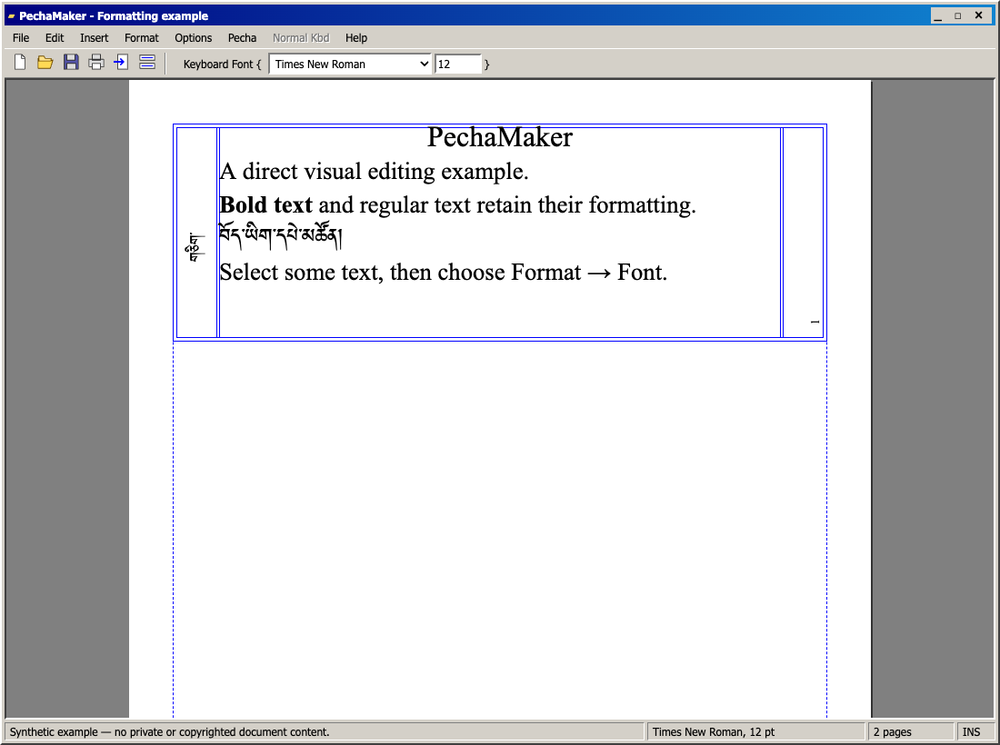
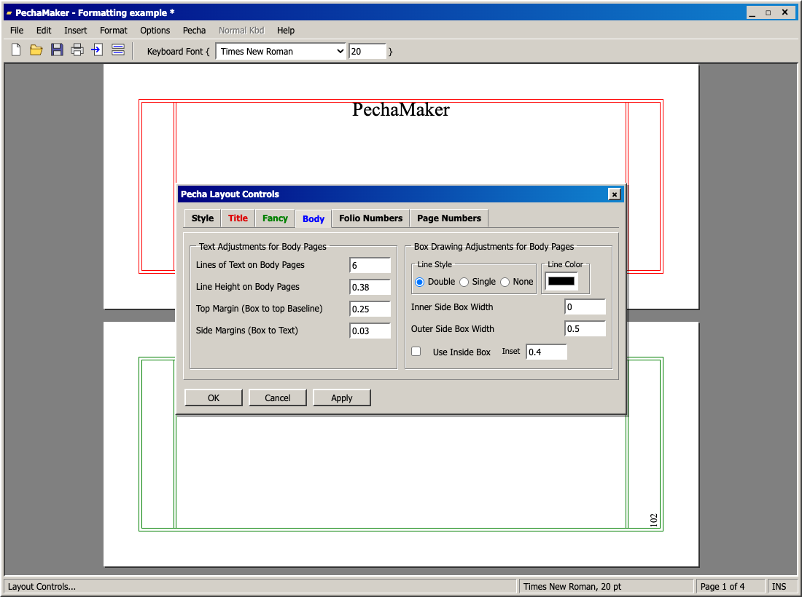
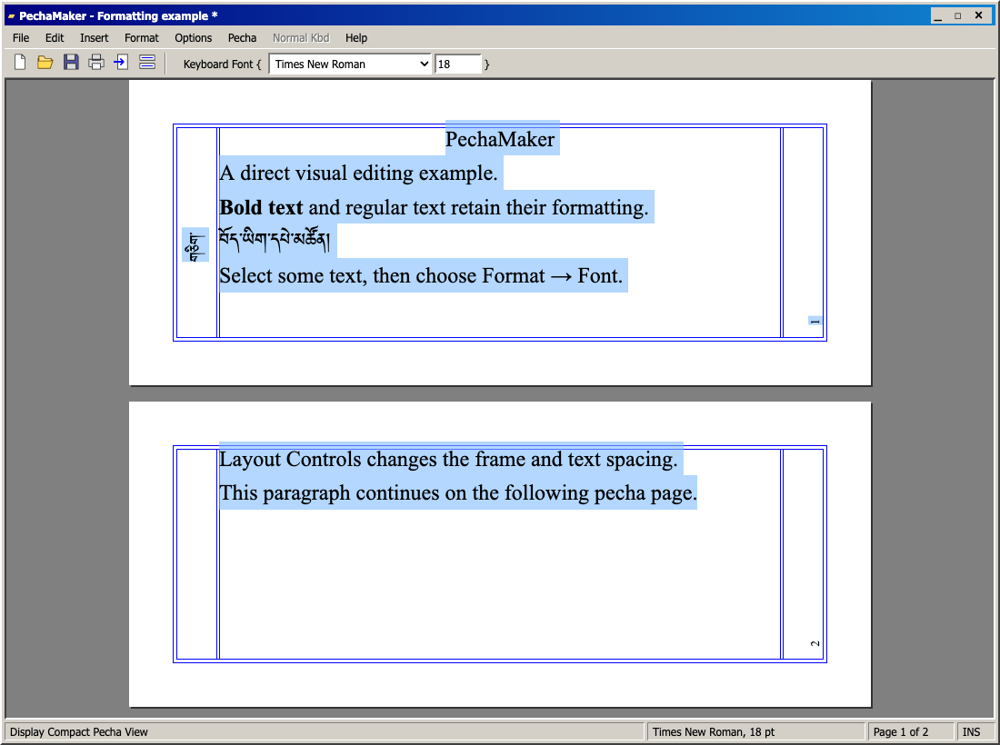

# Original desktop workflow rebuild

A separate, independently written UI and direct editor for the original Windows PechaMaker workflow. This is a review branch, not the production app. The previous `src/app.js`, its UI, and `docs/index.html` are unchanged.

Run from the repository root:

```sh
python3 -m http.server 8766 --bind 127.0.0.1
# Open http://127.0.0.1:8766/rebuild/
```

For the synthetic demonstration, choose **Help → Open synthetic example (rebuild)**. Type and select directly inside the pecha. Use the toolbar or **Format → Font**, and **Pecha → Layout Controls**. **File → Save** downloads `.pecha-web` files. **File → Print** uses the browser print dialog, including Save as PDF. Native `.pxp` files are not yet connected to this editor.

```sh
npm ci --prefix rebuild
node rebuild/test/editor.browser.mjs
```

The browser suite uses installed Chrome, runs against the server above, and writes screenshots/PDFs under ignored `rebuild/test-output/`. `BASE_URL` can override the URL.

## Evidence and scope

The primary visual reference is the installed PechaMaker **2.0** User's Guide, especially figures 1–3, 6–14, and the 2.9 executable's menu/dialog labels. The older downloadable guide is version 1.14. Source evidence was inspected privately; neither original screenshots, proprietary executable assets, decompiled code, nor user documents are included here. Icons are independently drawn SVG. The existing independently implemented `src/folio.js` is reused for Unicode number words; the previous UI/layout engine is not used.

This is not verified runtime parity with Windows 2.9. [SCREEN-MAP.md](SCREEN-MAP.md) separates implemented interactions from unfinished surfaces and assumptions. Browser rendering, Unicode fonts, and PDF metrics differ from the original GDI/legacy fonts. The web file format is deliberately distinct from PXP.

## Current review screenshots

These are synthetic examples rendered by the rebuild, not original PechaMaker screenshots.






